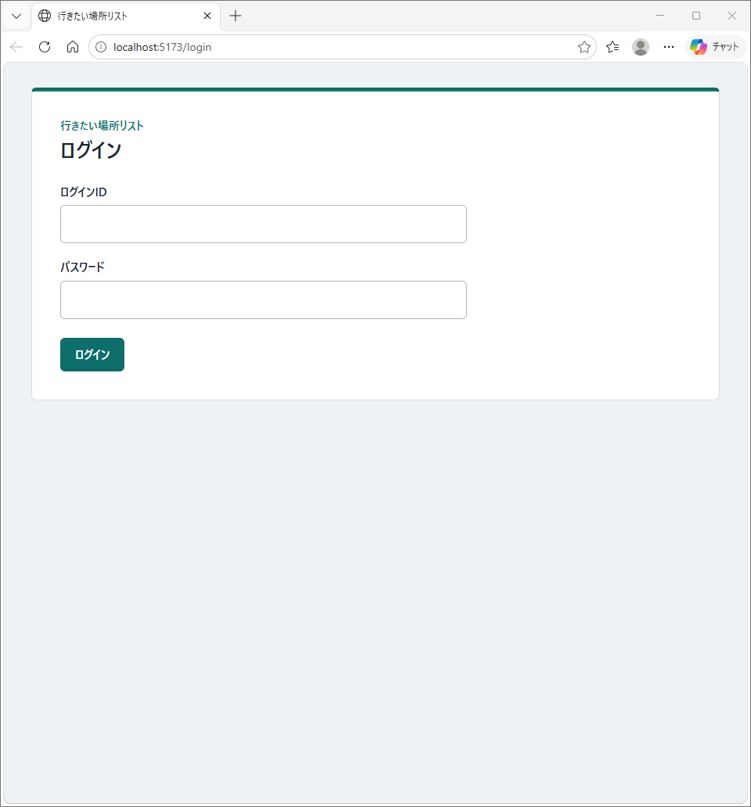
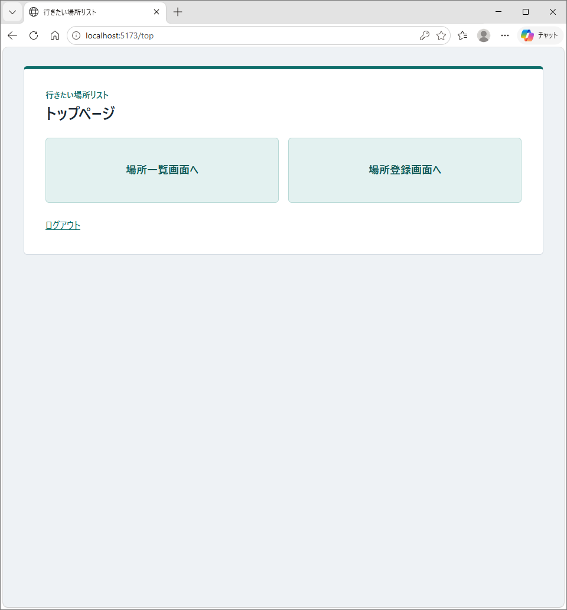
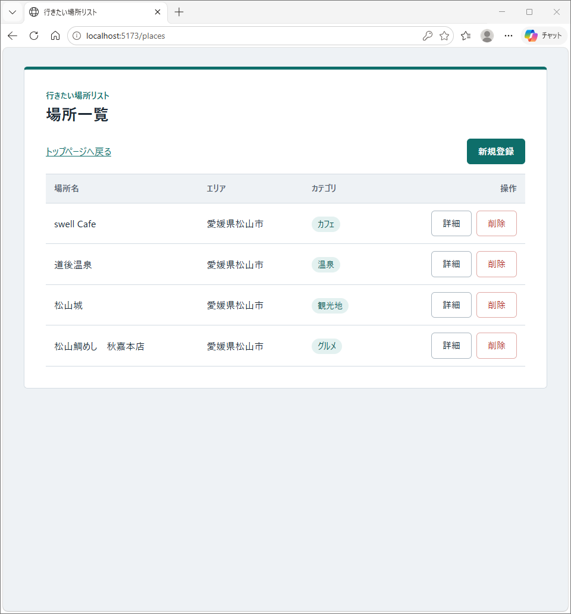
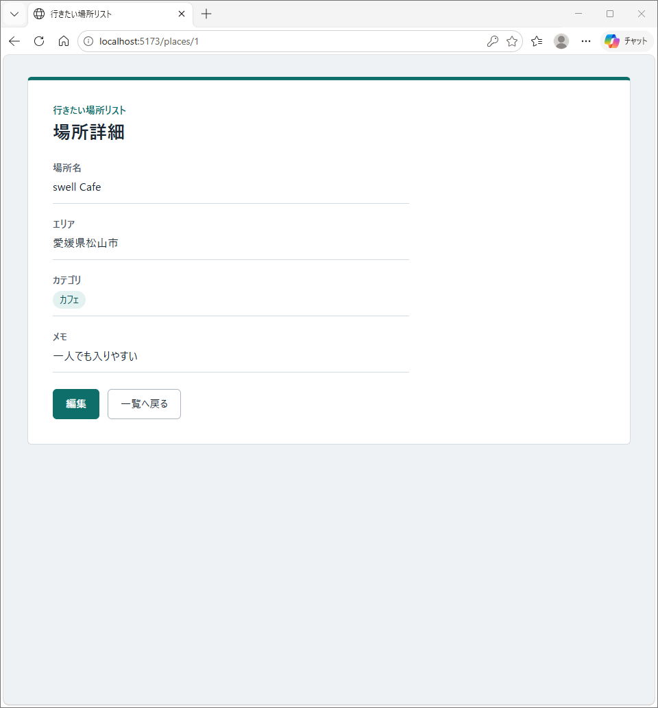
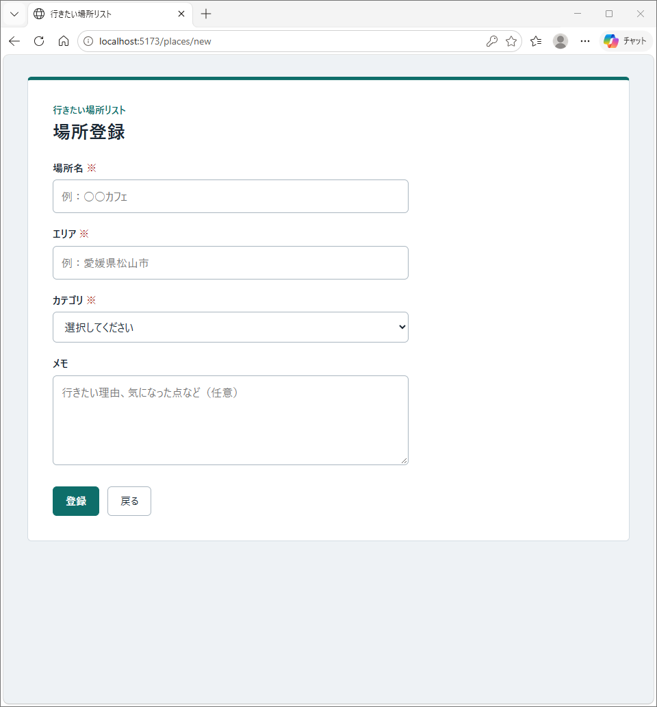
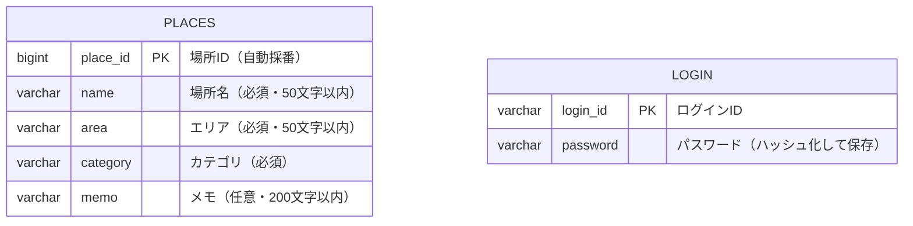

# 行きたい場所リスト

**気になった場所を、あとで探さなくてもいいように、ひとつの一覧にまとめて記録できるWebアプリです。**

## アプリケーションの概要

「行ってみたい」と思った場所（カフェ、グルメ、観光地、温泉など）を、場所名・エリア・カテゴリ・メモつきで登録し、一覧で見返せるアプリです。
ログインした利用者だけが、場所の登録・詳細表示・編集・削除をできます。

## 開発した背景や理由
SNSやお店のページで見つけた「行ってみたい場所」は、メモアプリや写真、ブックマークに散らばってしまい、出かけるときに探す手間がかかります。
そこで、場所名・エリア・カテゴリ・メモを1か所にまとめて、あとで見返しやすくするアプリを作りました。

### 工夫した点

- 入力チェックを、画面側とサーバー側の両方で行い、エラーメッセージの文言をそろえました。
- 削除は一覧画面からだけ行えるようにして、押したときに確認ダイアログを出し、誤って消さないようにしました。
- マウスオーバー時にわかりやすいよう色を少し暗めにしました。
- カテゴリを、自由入力ではなくプルダウンにして、入力ミスや表記ゆれを防いでいます。

### 苦労した点・つまずいたところ

- **アプリを作るのが初めてで、進め方から迷った**: 知識としては勉強していましたが、実際に作るとなると、何から手をつけるか、どの順番で進めるかが分からず、最初からつまずきました。AIに相談したりWebで検索しながら、実装しました。
- **パソコンの空き容量が足りなかった**: 空きが約1GBしかなく、開発に必要なツールを入れられませんでした。容量を調べるツール（WizTree）で何が使っているかを調べ、不要なファイルを整理して空きを作りました。
- **Maven が入っていなかった**: バックエンドを起動するコマンド（mvn）が使えませんでした。Maven Wrapper（`mvnw`）をプロジェクトに入れることで、Maven を別に入れなくても起動できるようにしました。

### 開発の進め方

設計書の下書きとアプリのコードは、AIによる支援やWeb検索を活用して作成しました。
作成したものは自分のパソコンで実際に動かし、動作を確認しました。
その過程で、コードや設計の内容を一つずつ理解しながら開発を進めました。
AIの出力をそのまま使うのではなく、内容を調べて理解したうえで取り入れるようにしました。

## アプリケーションのURL

本番環境には公開していません。ローカル環境で起動して確認します（起動方法は下に記載しています）。

**テスト用アカウント**

| ログインID | パスワード |
|---|---|
| user | password |

## アプリケーションのデモ

| ログイン画面 | トップページ |
|---|---|
|  |  |
| ログインIDとパスワードで認証します。 | 一覧と登録への入口です。 |

| 場所一覧画面 | 場所詳細画面 |
|---|---|
|  |  |
| 登録した場所を一覧で見られます。詳細・削除ができます。 | 場所名・エリア・カテゴリ・メモを確認できます。 |

| 場所登録画面 | 場所編集画面 |
|---|---|
|  |  |
| 必須項目の入力チェックがあります。 | いまの内容を表示して、書き換えられます。 |

## 主な機能

- ログイン（IDとパスワード）
- 場所の一覧表示
- 場所の詳細表示
- 場所の登録（入力チェックつき）
- 場所の編集
- 場所の削除（確認ダイアログつき）
- ログインしていないときは、画面もAPIも使えない

## 使用技術

| Category | Technology Stack |
|---|---|
| Frontend | JavaScript, React, Vite |
| Backend | Java 21, Spring Boot, Spring Data JPA |
| Authentication | セッション認証, パスワードのハッシュ化（BCrypt） |
| Database | H2 |
| Build tool | Maven（Maven Wrapper）, npm |
| Design | draw.io, Excel |
| etc. | Git, GitHub |

## ER図



`places` は行きたい場所の情報、`login` はログイン用の情報を管理します。2つのテーブルは、お互いに関連を持たない独立したテーブルです。

## ローカル環境での起動方法

### 必要環境

- Java 17 以上
- Node.js 18 以上
- Git

### インストール手順

```bash
# 1. リポジトリをクローン
git clone https://github.com/fglkb8-cmyk/places-app.git
cd places-app

# 2. バックエンド（Spring Boot）を起動
cd backend
mvnw.cmd spring-boot:run      # Mac / Linux の場合は  sh mvnw spring-boot:run
# http://localhost:8080 で起動します
# （データベースは H2 なので、作成は不要です）

# 3. フロントエンド（React）を起動（別のターミナルで実行）
cd places-app/frontend
npm install
npm run dev
# http://localhost:5173 で起動します
```

ブラウザで http://localhost:5173 を開き、`user` / `password` でログインしてください。
 
